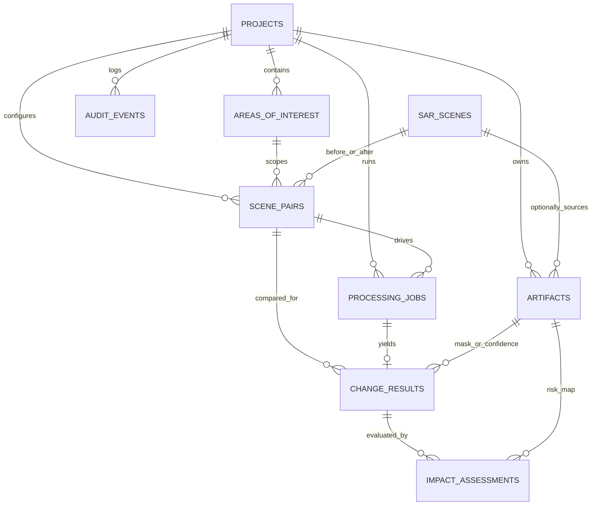

# SPECTRA-SAR — T03 Data Model & ERD

## Entities and relationships

## Source of truth and ownership

| Entity | Owner / producer | Purpose |
|---|---|---|
| projects / areas_of_interest | M5 API with frontend input | Study configuration, polygon geometries in EPSG:4326 |
| sar_scenes | M1 | Real, traceable scene metadata; STAC item JSON |
| scene_pairs | M1 gatekeeper + M5 | Before/after image pairs, scientific validation |
| processing_jobs | M5 queue | Lifecycle/status/failures and idempotency |
| artifacts | M1/M2/M3 through M5 storage | Immutable object-store URI and SHA256 when known |
| change_results | M2 | Changes, confidence, algorithm versions, evaluation |
| impact_assessments | M3 | Geographic footprint, risk assessment with methods |
| audit_events | M5/M6 | Traceability, not an authorization table |

## Relational rules

- UUID primary keys, UTC timestamps (`TIMESTAMPTZ`) and explicitly named constraints.
- Foreign keys protect provenance and restrict accidental deletion of scientific outputs.
- `geometry(MULTIPOLYGON, 4326)` used for AOIs, scene footprints and impact regions; GiST indexes support spatial lookup.
- Storage URI points to object storage; do **not** put large GeoTIFF/COG data in PostgreSQL.
- STAC item JSON is retained for traceability; geospatial metadata and original acquisition are not fabricated.
- Confidence is 0–1 *when defined*. Null means unavailable, not zero.

## Important contracts to confirm with members

1. **M1:** STAC source/provider IDs, metadata normalization, valid product type/polarization naming, geometry conventions, pair matching and acquisition chronology.
2. **M2:** mask semantics, unit for changed area, confidence calibration and evaluation metrics.
3. **M3:** risk assessment classification, population data provenance, impacted infrastructures, uncertainty and output schema.
4. **M4:** query/filter/pagination and rendering formats GeoJSON, map tiles, COG URLs.
5. **M6:** actor identity, audit retention, permission model and storage credential management.

## Deliberately deferred to T04+

- Versioned Alembic migration, live PostGIS connectivity, storage access and API persistence services.
- Application/trigger cross-table guards (e.g. AOI and pair belong to same project; after-acquisition truly occurs after before-acquisition; artifact ownership; correct job type on result).
- Actors authenticated in T10; `audit_events.actor_id` is only a placeholder identity field.
- Infrastructure-specific exposure tables require M3's confirmed external datasets to avoid invented values.
